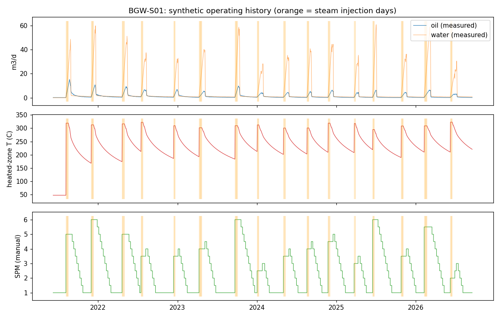
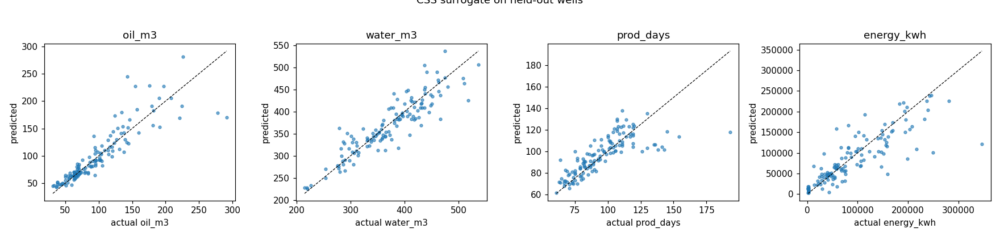
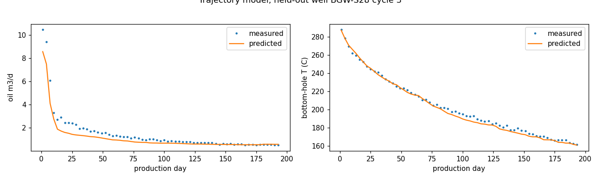
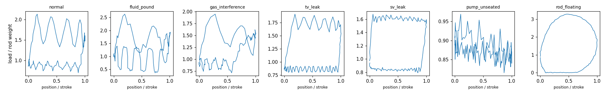
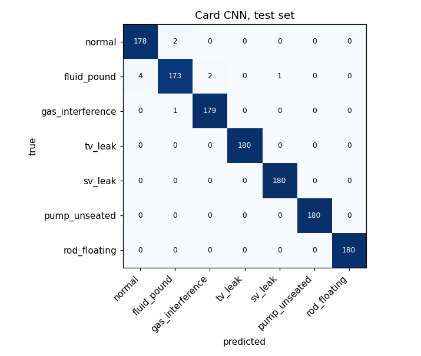
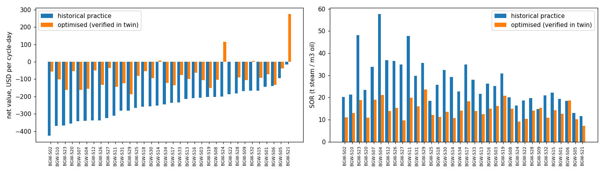
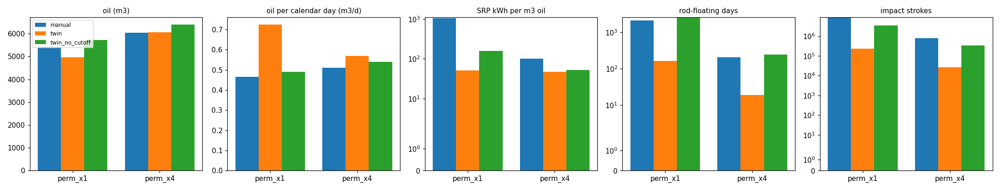

# Baghewala CSS + SRP Digital Twin — results report

All numbers below are produced by `python -m twin.cli all` and read from `artifacts/`.
**The training data are SYNTHETIC** (generated by the physics twin), because Baghewala
field data are not public. The pipeline is built so OIL's real `wells/cycles/daily` tables
can replace the synthetic ones (see README).

Verification suite: `34 passed in 2.21s`

## 1. Parameter provenance
92 parameters: {'assumption': 81, 'published': 7, 'problem_statement': 2, 'physical_constant': 2}. Every value has a source in `config/field.yaml`;
`python -m twin.cli params` prints them all. Published / problem-statement values used:

| parameter | value | unit | source |
|---|---|---|---|
| field.n_producing_wells | 34 | dimensionless | Oil India Ltd, Rajasthan Fields page (https://www.oil-india.com/rajasthan-fields): '56 nos. of wells have already been drilled out of which 34 nos. of wells are in production' |
| field.field_rate_bopd_reported | 1202 | dimensionless | BusinessToday, 2026-04-05: record 1,202 bbl/d from Jodhpur sandstone, Baghewala (used ONLY as a sanity check, never as a model input) |
| field.css_first_date | 2018-12-01 | date | Oil & Gas Journal, Dec 2018: 'OIL starts CSS of well in Rajasthan' (BGW-8, India's first CSS) |
| field.cold_to_hot_rate_ratio_reported | [5.0, 6.0] | dimensionless | OIL CSS pilot summary (Scribd doc 444099090): 'five to six fold increase in production after steam injection' (sanity check only) |
| reservoir.depth | 1150 | m | OIL Rajasthan Fields page: 'Jodhpur Sandstone (Heavy Oil Reservoir with avg. depth of 1150 m)' |
| reservoir.temperature | [46.0, 48.0] | degC | Problem statement: reservoir temperature 46-48 C |
| oil.api_gravity | [17.0, 19.0] | dimensionless | Problem statement: 17-19 API (Basha et al. 2015 quote 14-18 API) |
| oil.viscosity_at_ref | [10000.0, 13000.0] | cP | OIL Rajasthan Fields page: 'crude oil viscosity is in the range of 10,000-13,000 cP at 50 deg C' |
| oil.viscosity_ref_temperature | 50.0 | degC | OIL Rajasthan Fields page (same statement) |

## 2. Synthetic field vs published figures (sanity checks — NOT fitted)
| check | synthetic | published |
|---|---|---|
| field oil rate, last 365 days of history | 127 bopd | ~1,100–1,202 bopd (OIL website; BusinessToday 2026) |
| mean cycle-1 oil rate / pre-steam cold rate (median over wells) | 10.4× | "five to six fold" (OIL CSS pilot) |
| cycles simulated | 636 over 34 wells | 34 producing wells |

The synthetic field produces **far less than the real field**: the assumed (unpublished)
reservoir properties and tubing-flow assumptions are pessimistic. Absolute numbers from
this twin therefore must not be read as Baghewala forecasts; relative comparisons
(model vs baseline, policy A vs B) are what the synthetic study supports.

## 3. CSS cycle surrogate (trained from scratch, test = 7 unseen wells)
Train 505 cycles / test 131 cycles. Model per target chosen
by grouped CV on training wells only (`*`). `previous` = repeat the well's last cycle
(historical-experience baseline).

| target | model | cv_r2 | r2 | mae | mape |
|---|---|---|---|---|---|
| oil_m3 | gbm | 0.670 | 0.682 | 16.716 | 0.156 |
| oil_m3 | ridge | 0.707 | 0.732 | 16.686 | 0.163 |
| oil_m3 | ensemble * | 0.783 | 0.768 | 14.131 | 0.132 |
| oil_m3 | mean |  | -0.008 | 36.658 | 0.427 |
| oil_m3 | previous |  | 0.551 | 22.053 | 0.243 |
| water_m3 | gbm | 0.722 | 0.797 | 24.136 | 0.066 |
| water_m3 | ridge | 0.781 | 0.744 | 25.285 | 0.067 |
| water_m3 | ensemble * | 0.792 | 0.816 | 21.189 | 0.056 |
| water_m3 | mean |  | -0.024 | 55.685 | 0.157 |
| prod_days | gbm | 0.471 | 0.612 | 8.922 | 0.088 |
| prod_days | ridge | 0.428 | 0.399 | 11.300 | 0.113 |
| prod_days | ensemble * | 0.492 | 0.579 | 9.350 | 0.092 |
| prod_days | mean |  | -0.000 | 17.228 | 0.186 |
| prod_days | previous |  | -0.864 | 22.718 | 0.244 |
| energy_kwh | gbm * | 0.715 | 0.692 | 25058.438 | 0.759 |
| energy_kwh | ridge | 0.385 | 0.431 | 38146.074 | 0.887 |
| energy_kwh | ensemble | 0.628 | 0.631 | 28761.402 | 0.714 |
| energy_kwh | mean |  | -0.008 | 57517.376 | 5.104 |
| SOR (derived) | selected |  | 0.857 | 2.079 | 0.126 |

## 4. Heating/cooling & production trajectory model
| target | model | r2 | mae | mape |
|---|---|---|---|---|
| oil_m3d | gbm | 0.926 | 0.219 | 0.253 |
| oil_m3d | mean_profile | 0.708 | 0.489 | 0.814 |
| t_bottom | gbm | 0.991 | 2.457 | 0.011 |
| t_bottom | mean_profile | 0.799 | 11.725 | 0.054 |

## 5. Dynamometer-card CNN (PyTorch, random init)
102759 parameters; initial validation loss 1.949 (chance ln7 = 1.946)
→ best 0.0351 after 40 epochs.
Test accuracy **0.9921** (macro-F1 0.9920) vs logistic regression
0.9357. Independent robustness set (new seed, 3× sensor noise):
CNN 0.9800 vs logistic regression
0.8971.
Rod floating is also caught by the simple physics rule (min measured load ≤ 0.01·W_air,
F1 1.000) — detection is easy; *preventing* it is the SRP controller's job (§7).
Caveat: synthetic cards are cleaner than field cards; expect lower accuracy on real data.

| class | precision | recall | f1-score | support |
|---|---|---|---|---|
| normal | 0.978 | 0.989 | 0.983 | 180.000 |
| fluid_pound | 0.983 | 0.961 | 0.972 | 180.000 |
| gas_interference | 0.989 | 0.994 | 0.992 | 180.000 |
| tv_leak | 1.000 | 1.000 | 1.000 | 180.000 |
| sv_leak | 0.994 | 1.000 | 0.997 | 180.000 |
| pump_unseated | 1.000 | 1.000 | 1.000 | 180.000 |
| rod_floating | 1.000 | 1.000 | 1.000 | 180.000 |

**Live operating points** (cards generated at the live twin's daily conditions, both fleets, n=314): exact agreement with the physics label 0.815; 0.939 when fluid pound and gas interference are grouped as 'incomplete fillage' (in this pump model both mean a chamber part-filled with gas at intake pressure, differing only in that pressure). Injected faults: 1.000 (n=24).

## 6. CSS optimisation (surrogate search → physics-twin verification)
For each of 34 wells, next-cycle controls were searched with the surrogate inside the
training-data envelope; the top candidates and the well's last (historical-practice) controls were
re-simulated in the physics twin from the well's actual state.
Verified improvement in net value/cycle-day on 34/34 wells (median
+165 USD/day); median SOR 24.3 → 14.0.
Median |surrogate-predicted − verified| value: 22 USD/day. Economics use
placeholder prices from `config/field.yaml` — replace with OIL figures.

## 7. SRP control: reactive manual practice vs twin controller
Next 3 cycles per well, identical CSS controls and noise. Policies:
`manual` = reactive operator rules; `twin` = controller + lift-limited cut-off (ends the cycle
when no SPM/ratio within unit limits avoids floating and overload, protecting the rods);
`twin_no_cutoff` = controller only. The cut-off trades oil for rod protection; there is no
rod-failure cost model, so the choice between the two twin variants is left to the operator.
`perm_x4` is a sensitivity case (4× permeability).

| scenario | policy | oil_m3 | calendar_days | oil_per_calendar_day | sor | kwh_per_m3_oil | floating_days | overload_days | impact_strokes |
|---|---|---|---|---|---|---|---|---|---|
| perm_x1 | manual | 5420.96 | 11637.00 | 0.47 | 25.44 | 1060.22 | 2144.00 | 2145.00 | 8764560.00 |
| perm_x1 | twin | 4958.40 | 6834.00 | 0.73 | 27.81 | 51.04 | 163.00 | 174.00 | 234720.00 |
| perm_x1 | twin_no_cutoff | 5717.67 | 11637.00 | 0.49 | 24.12 | 159.51 | 2484.00 | 2498.00 | 3576960.00 |
| perm_x4 | manual | 6047.75 | 11863.00 | 0.51 | 24.12 | 100.09 | 208.00 | 216.00 | 789840.00 |
| perm_x4 | twin | 6067.91 | 10673.00 | 0.57 | 24.04 | 46.77 | 19.00 | 34.00 | 27360.00 |
| perm_x4 | twin_no_cutoff | 6403.18 | 11863.00 | 0.54 | 22.78 | 52.65 | 241.00 | 276.00 | 347040.00 |

FD-model spot checks of twin decisions on days it judged feasible:
{"perm_x1": {"n": 204, "fd_floating": 0, "min_fd_load_kN": 1.6504396576592208}, "perm_x4": {"n": 204, "fd_floating": 0, "min_fd_load_kN": 1.947197294373655}}
FD confirmation of manual floating days: {"perm_x1": {"n": 46, "fd_confirms_floating": 46}, "perm_x4": {"n": 12, "fd_confirms_floating": 12}}
(floating = FD minimum polished-rod load < 0).

## 8. Limitations (read before using any number)
* Training data are synthetic; 81 of the 92 parameters are assumptions (see §1).
* Reservoir model: single-layer, radial, lumped heated zone, two-region pressure, Dupuit gravity
  drainage; no steam flashing/solution-gas drive, no geomechanics, no inter-well interference.
* Tubing flow: oil-/water-continuous switch at an assumed inversion water cut; emulsion
  viscosity increase ignored; rod drag uses annular Couette flow (fluid flow neglected).
* Card model: single-taper rods, harmonic polished-rod motion, no tubing stretch, ideal valves
  (plus laminar leaks); field cards contain effects not modelled here.
* Surrogate is only valid inside the training envelope of controls; the optimiser is constrained to it.
* SRP results are dominated by the assumed emulsion inversion water cut and VIT heat-transfer
  coefficient: below the inversion point the tubing flow uses cold-oil viscosity (10^4–10^5 cP near
  surface), which is what makes floating frequent. Measure both before trusting SRP numbers.
* There is no rod-failure / workover cost model, so the twin cannot price rod protection against
  lost oil; both twin variants are reported and the energy objective uses placeholder prices.
